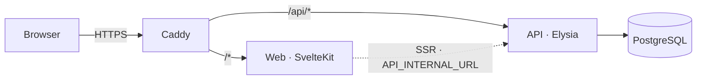
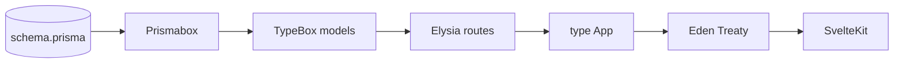

# Deckhand

> A self-hostable, end-to-end typed stack built entirely with Bun.

[](https://github.com/Deckhandhq/deckhand/actions/workflows/ci.yml)
[](https://github.com/Deckhandhq/deckhand/actions/workflows/docker.yml)


[](https://hub.docker.com/u/epitexam)

Deckhand pairs a **modular Elysia + Prisma backend** with a **SvelteKit frontend**. It is published as multi-arch Docker images, so running it on a VPS only requires Docker. In-depth guides live in the [documentation site](https://deckhandhq.github.io/deckhand-docs/).

## Stack

| Layer             | Technology                                                         |
| ----------------- | ------------------------------------------------------------------ |
| Runtime & tooling | Bun 1.4 — package manager, tests, type checker, formatter, bundler |
| API               | Elysia 1.4 with Prismabox validation, OpenAPI and `llms.txt`       |
| Database          | PostgreSQL 17 with Prisma ORM 7 and the `pg` driver adapter        |
| Frontend          | SvelteKit 3, Svelte 5, `@sveltejs/adapter-bun`                     |
| Hosting           | Docker Compose, Caddy with automatic TLS                           |

## Highlights

- **Modular monolith** — Elysia plugins with explicit dependencies and isolated lifecycles.
- **End-to-end types** — Eden Treaty infers the API from `type App`; no code generation.
- **Schema-driven validation** — Prismabox turns the Prisma schema into TypeBox models reused by Elysia, OpenAPI and Eden.
- **Self-hosting first** — healthchecks, backups, pinned releases and a single `docker compose up -d`.

## Architecture



The browser always calls the API on the **same origin** — no CORS setup. Caddy is optional; without it, the web service proxies `/api` itself. During SSR, the web server reaches the API directly over the Docker network.

### Type flow



Change a field in the Prisma schema, regenerate, and both the backend validation and the frontend types follow.

## Repository layout

```txt
apps/
├── api/              # Elysia monolith — exports `type App`
└── web/              # SvelteKit + Eden client
packages/
└── database/         # Prisma schema, client and Prismabox models
scripts/              # backup, restore, update
docs/DEPLOYMENT.md    # VPS hardening notes
```

## Get started

Download the single stack file, edit the database password and public URL, then start it:

```bash
curl -fsSLO https://github.com/Deckhandhq/deckhand/releases/latest/download/docker-compose.yml
$EDITOR docker-compose.yml
docker compose up -d
```

Caddy is optional: `docker compose --profile proxy up -d` enables the recommended HTTPS reverse proxy. Without it, point your own HAProxy/Nginx at `127.0.0.1:3000` — the app proxies `/api` itself.

Full prerequisites, configuration and operations are in the [documentation site](https://deckhandhq.github.io/deckhand-docs/). Developers can jump to [`AGENTS.md`](AGENTS.md) for local commands and conventions.

## Releases

Pushing a `v*` tag publishes `epitexam/deckhand-api` and `epitexam/deckhand-web` to Docker Hub for `amd64` and `arm64`, creates a GitHub Release with the stack files, and runs a smoke test against the published images.

## Roadmap

- [ ] Better Auth on the API with the Prisma adapter
- [ ] A first real domain module
- [ ] Playwright and Storybook checks in CI
- [ ] OpenTelemetry observability
