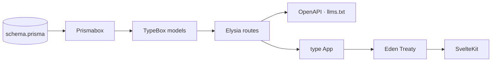

# Deckhand

> **Self-hostable, end-to-end typed stack.** Bun runtime · Elysia API · Prisma 7 · SvelteKit frontend.

[](https://github.com/Deckhandhq/deckhand/actions/workflows/ci.yml)
[](https://github.com/Deckhandhq/deckhand/actions/workflows/docker.yml)


[](https://hub.docker.com/u/epitexam)

Deckhand is a **two-service application** published as Docker images. Pull the stack files from a GitHub Release, set a handful of environment variables, and run `docker compose up -d`. No Bun, Node, or source checkout is needed on the server.

## Why Deckhand

- **Modular monolith backend** — Elysia plugins with explicit dependencies, TypeBox validation, centralized errors, OpenAPI and `llms.txt`.
- **Typed frontend** — Eden Treaty infers the API directly from `type App`; no code generation, no drift.
- **Database-first schemas** — Prismabox generates validation models from `schema.prisma` for both runtime validation and documentation.
- **Self-hosting by default** — PostgreSQL, Caddy with automatic TLS, healthchecks, backups, and multi-arch images.

## Contents

- [Architecture](#architecture)
- [Quick start (VPS)](#quick-start-vps)
- [Configuration](#configuration)
- [Operations](#operations)
- [Repository layout](#repository-layout)
- [Development](#development)
- [Type safety](#type-safety)
- [Releasing](#releasing)
- [Troubleshooting](#troubleshooting)
- [Roadmap](#roadmap)

## Architecture


1. Caddy terminates TLS and strips the `/api` prefix before proxying to the API.
2. The browser calls the API on the **same origin** — no CORS configuration.
3. During SSR, the web server talks directly to `api:3000` over the Docker network.
4. Elysia uses the shared Prisma Client to read and write data.

### How the types flow



## Quick start (VPS)

### Prerequisites

- [ ] A Linux VPS with Docker and Docker Compose
- [ ] A CPU with **AVX2** support (required by Bun)
- [ ] DNS records pointing to the VPS, with ports **80** and **443** open
- [ ] A domain name (or `localhost` for a local trial)

### Install

```bash
mkdir deckhand && cd deckhand
BASE=https://github.com/Deckhandhq/deckhand/releases/latest/download

for f in docker-compose.yml .env.example Caddyfile DEPLOYMENT.md backup.sh restore.sh update.sh; do
  curl -fsSLO "$BASE/$f"
done
chmod +x backup.sh restore.sh update.sh

cp .env.example .env
$EDITOR .env      # DOMAIN, POSTGRES_PASSWORD, BETTER_AUTH_SECRET, DECKHAND_VERSION
docker compose up -d
```

Open `https://your-domain.com`. Caddy provisions the certificate automatically.

> [!IMPORTANT]
> Pin `DECKHAND_VERSION` to a released tag such as `0.1.0` instead of leaving `latest`. Upgrades then become an explicit, reversible action.

Images: [`epitexam/deckhand-api`](https://hub.docker.com/r/epitexam/deckhand-api) and [`epitexam/deckhand-web`](https://hub.docker.com/r/epitexam/deckhand-web), both published for `linux/amd64` and `linux/arm64`. The API applies pending Prisma migrations on startup; data lives in the `postgres_data` volume.

See [`docs/DEPLOYMENT.md`](docs/DEPLOYMENT.md) for the full hardening checklist.

## Configuration

| Variable                        | Default             | Purpose                                |
| ------------------------------- | ------------------- | -------------------------------------- |
| `DOCKERHUB_USER`                | `epitexam`          | Image namespace                        |
| `DECKHAND_VERSION`              | `latest`            | Image tag — **pin this in production** |
| `COMPOSE_PROJECT_NAME`          | `deckhand`          | Prefix for volumes and network         |
| `DOMAIN`                        | `localhost`         | Public hostname used by Caddy          |
| `ORIGIN`                        | `https://localhost` | Public origin used by SvelteKit        |
| `POSTGRES_DB` / `POSTGRES_USER` | `deckhand`          | Database credentials                   |
| `POSTGRES_PASSWORD`             | `change-me`         | Database password — avoid `@ / # : ?`  |
| `BETTER_AUTH_SECRET`            | —                   | Reserved for the upcoming auth module  |
| `BETTER_AUTH_URL`               | `https://localhost` | Reserved for the upcoming auth module  |
| `API_CPUS` / `API_MEM`          | `1.0` / `512m`      | API resource limits                    |
| `WEB_CPUS` / `WEB_MEM`          | `1.0` / `512m`      | Web resource limits                    |

## Operations

| Task    | Command                                |
| ------- | -------------------------------------- |
| Health  | `curl -k https://$DOMAIN/api/health`   |
| Logs    | `docker compose logs -f api web caddy` |
| Update  | `./update.sh`                          |
| Backup  | `./backup.sh`                          |
| Restore | `./restore.sh backups/<timestamp>`     |
| Status  | `docker compose ps`                    |

> [!WARNING]
> Never roll back to an older image after a destructive migration without restoring a backup first.

## Repository layout

```txt
.
├── apps/
│   ├── api/                # Elysia monolith — exports `type App`
│   └── web/                # SvelteKit + @sveltejs/adapter-bun
├── packages/
│   └── database/           # Prisma schema, client, Prismabox models
├── scripts/                # backup / restore / update
├── docs/DEPLOYMENT.md      # VPS hardening checklist
├── Dockerfile              # targets: api, web
├── docker-compose.yml      # postgres + api + web + caddy
└── Caddyfile
```

## Development

Requires Bun 1.4 and Docker.

```bash
bun install
cp .env.example .env
docker compose up -d postgres
bun run db:migrate
bun run dev        # API :3000 · Web :5173
```

The `predev` script regenerates the Prisma Client and Prismabox models. Useful endpoints on the API: `/health`, `/openapi`, `/openapi/json`, `/llms.txt`.

| Command                                                                   | Purpose                                                    |
| ------------------------------------------------------------------------- | ---------------------------------------------------------- |
| `bun run build` / `bun run start`                                         | Build and run both apps                                    |
| `bun run db:generate` / `db:migrate` / `db:deploy` / `db:seed` / `studio` | Prisma tooling                                             |
| `bun test`                                                                | `bun:test` suite, including in-process `treaty(app)` tests |
| `bun run typecheck`                                                       | `bun check .` + `svelte-check`                             |
| `bun run fmt` / `fmt:check`                                               | Bun formatter                                              |

## Type safety

The backend exports its type from `app.ts` — never from the file that calls `.listen()`:

```ts
// apps/api/src/app.ts
export type App = typeof app;
```

The frontend builds its client around that type:

```ts
// apps/web/src/lib/api/client.ts
const api = treaty<App>(baseUrl, { fetcher });
```

Elysia versions are aligned through the root `catalog`, and request/response schemas come from Prismabox. Change a field in `schema.prisma`, regenerate, and the frontend follows immediately.

## Releasing

Maintainers publish a release by pushing a tag:

```bash
git tag v0.1.0
git push origin v0.1.0
```

The `Docker` workflow then:

1. runs the CI checks;
2. builds `api` and `web` for `amd64` and `arm64`, with provenance and SBOM;
3. pushes `0.1.0`, `sha-<commit>` and `latest` to Docker Hub;
4. creates a GitHub Release with the stack files attached;
5. runs a smoke test against the freshly published images.

## Troubleshooting

<details>
<summary><strong>TLS certificate fails</strong></summary>

Confirm that DNS resolves to the VPS, that ports 80 and 443 are reachable, and that `DOMAIN` in `.env` matches the public hostname. Caddy stores certificates in the `caddy_data` volume — back it up with the database.
</details>

<details>
<summary><strong>The page shows <code>API : unavailable</code></strong></summary>

Check `docker compose logs api`. In production the web container reaches the API through `API_INTERNAL_URL=http://api:3000`; make sure both containers are on the same Compose network and healthy.
</details>

<details>
<summary><strong>A container is unhealthy</strong></summary>

Run `docker compose ps` and `docker compose logs <service>`. The API healthcheck calls `/health`; the web healthcheck requests `/`. Both depend on Postgres being healthy first.
</details>

<details>
<summary><strong>Migrations fail at startup</strong></summary>

The API runs `prisma migrate deploy` before listening. Verify `DATABASE_URL` interpolation and that Postgres is healthy. Inspect the API logs for the exact Prisma error.
</details>

## Roadmap

- [ ] Better Auth on the API via `app.mount('/api/auth', auth.handler)` with the Prisma adapter
- [ ] A first real domain module replacing the health-only example
- [ ] Playwright and Storybook checks in CI
- [ ] OpenTelemetry-based observability

Agent instructions and conventions live in [`AGENTS.md`](AGENTS.md).
