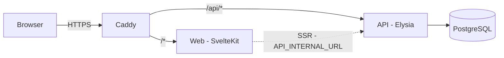

# Architecture overview

[Documentation index](../README.md) - [Type flow](type-flow.md) - [Services](services.md)

Deckhand is a two-service monorepo with a shared database package. The browser calls one origin; the reverse proxy, or the web service itself, forwards `/api` to the API.

## Stack

| Area | Choice |
|---|---|
| Runtime and tooling | Bun 1.4: package manager, tests, type checker, formatter, bundler |
| API | Elysia 1.4 with Prismabox validation, OpenAPI and `llms.txt` |
| Database | PostgreSQL 17 with Prisma ORM 7 and the `@prisma/adapter-pg` driver adapter |
| Frontend | SvelteKit 3, Svelte 5, `@sveltejs/adapter-bun` |
| Hosting | Docker Compose, Caddy with automatic TLS |

## Request paths

| Path | Behavior |
|---|---|
| Browser to API | Same origin under `/api`. No browser-side CORS handling is needed. |
| With Caddy | Caddy routes `/api/*` to the API and everything else to the web service. This is the recommended proxy profile. |
| Without Caddy | The web service proxies `/api` itself through its SvelteKit fallback route; point your own HAProxy or Nginx at `127.0.0.1:3000`. |
| Server-side rendering | The web server calls the API directly over the Docker network through `API_INTERNAL_URL`, without going through public TLS. |

> **Note** - Caddy is optional. The same-origin contract does not depend on it; only automatic TLS does. See [Deployment](../operations/deployment.md).

## Workspaces

| Package | Role |
|---|---|
| `@deckhand/api` | Elysia monolith; exports `type App` from `src/app.ts` |
| `@deckhand/web` | SvelteKit frontend and Eden client |
| `@deckhand/database` | Prisma schema, generated client, Prismabox models |

In development the API listens on port 3000 and the web app on port 5173, with a Vite proxy for `/api`. In the published stack both containers listen on port 3000; the API is exposed on the host at 3001 and the web app at 3000, with Caddy on 80 and 443 when enabled. See [Getting started](../guides/getting-started.md) and [Repository layout](../reference/repository-layout.md).

## Module boundaries

An API module is an Elysia instance with a name and a prefix, and explicit `.use()` dependencies. The current module is `health`; authentication and the forum are planned. Lifecycles are scoped by default. See [Services](services.md) and [Conventions](../reference/conventions.md).
