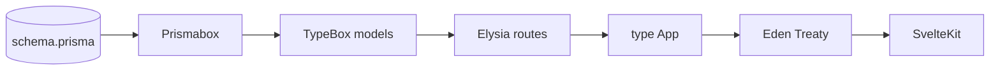

# Type flow

[Documentation index](../README.md) - [Architecture overview](overview.md) - [Data model](data-model.md)

A change to a Prisma schema field propagates to backend validation, OpenAPI documentation and the frontend client. There is no generated client on the frontend: Eden Treaty infers it from a type.

## Step by step

1. **Schema.** `packages/database/prisma/schema.prisma` defines the models. Prisma 7 uses the `prisma-client` generator, so the generated client lives in `packages/database/src/generated/prisma`.
2. **Validation models.** The `prismabox` generator emits TypeBox models into `src/generated/prismabox`. `packages/database/src/index.ts` re-exports them as `schemas`.
3. **Routes.** Elysia routes validate with those models. Validation is schema-driven, never type-only.
4. **App type.** `apps/api/src/app.ts` exports `type App = typeof app`. That file does not call `listen`; the server entry point does.
5. **Client.** The web app imports `type App` from `@deckhand/api/app` and builds a `treaty<App>` client. Type inference crosses the workspace boundary.

> **Warning** - Import `type App` from `@deckhand/api/app`, never from the package root. The root entry point calls `.listen()` and is meant for the server process. See [Conventions](../reference/conventions.md).

## Regeneration

Run `bun run db:generate` after a schema change. It is also run automatically as the `predev` step of `bun run dev`. The frontend needs no regeneration step: its types follow `type App` at compile time.

## Validation and responses

Because routes validate with TypeBox models derived from the schema, the same models feed Elysia validation and the OpenAPI document served by `@elysia/openapi`. Invalid input is mapped to a 422 by the shared error plugin. See [API](../guides/api.md).
